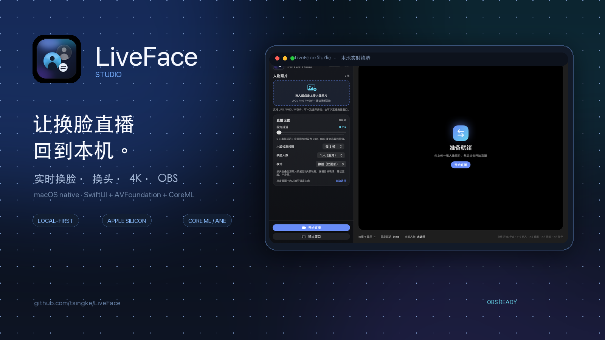
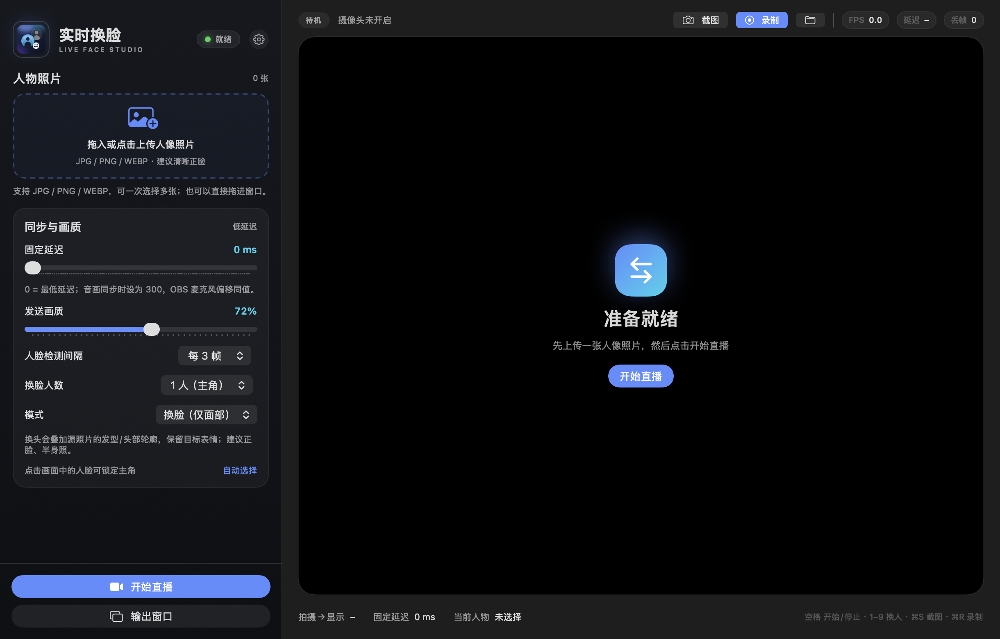
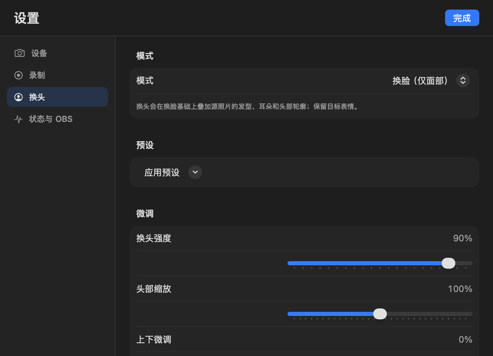
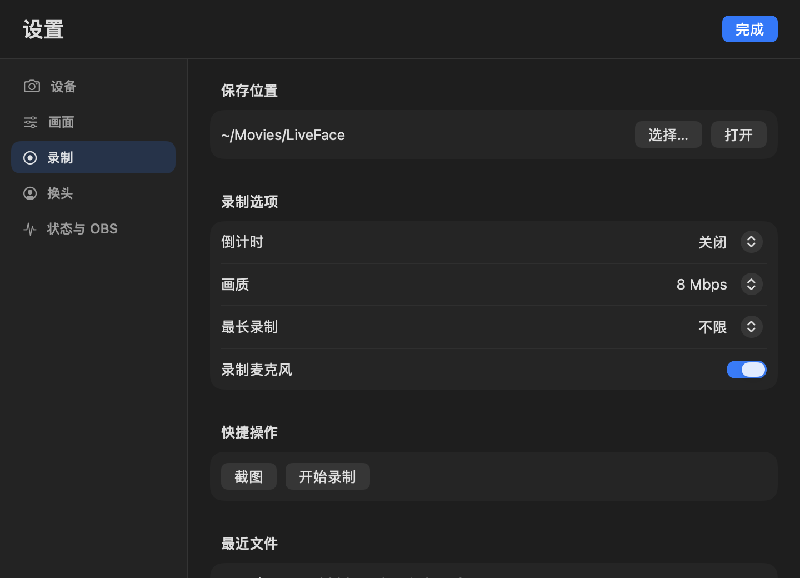
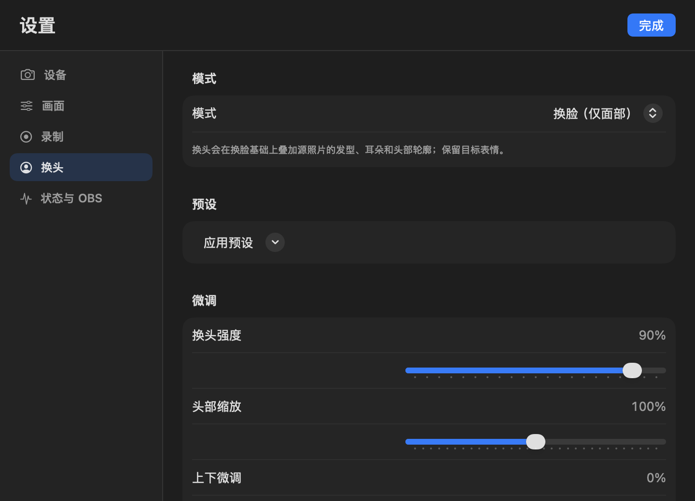
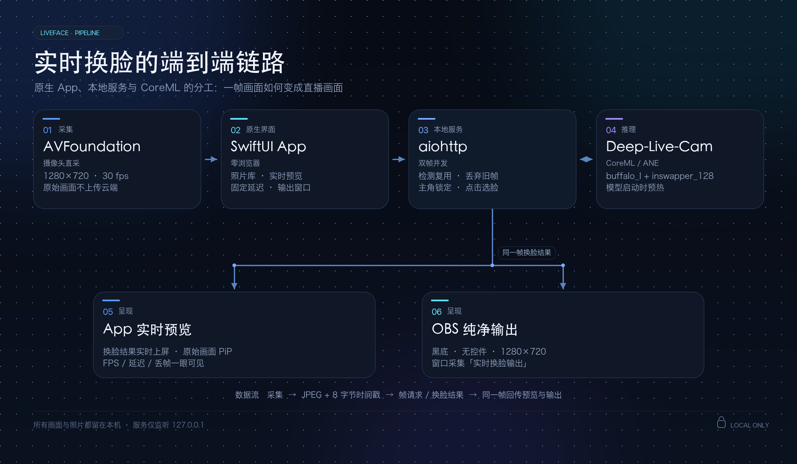

<p align="center">
  
</p>

<p align="center">
  
  
  
  
  
  
</p>

# LiveFace Studio

<p align="center">
  <b>原生 macOS 实时换脸 / 换头 · CoreML · 4K · OBS · 全本地</b><br>
  <sub>Native real-time face &amp; head swap for Apple Silicon Macs. Local by design.</sub>
</p>

<p align="center">
  <a href="https://tsingke.github.io/Deep-Live-Cam/"><b>官网 / 宣传页</b></a> ·
  <a href="#安装">安装</a> ·
  <a href="#画质--换头--录制">画质 / 换头 / 录制</a> ·
  <a href="docs/HANDOFF.md">开发与交接</a>
</p>

---

LiveFace Studio 把摄像头采集、换脸/换头模型、录音录像和 OBS 输出整合成一个**原生 macOS App**。  
没有浏览器套壳，没有云端上传；照片、画面和录音默认只在这台 Mac 上流动。

> **本仓库**：**整合增强版**：根目录包含完整 App 代码与上游 `modules/`，无需 submodule，`./install.sh` 一键安装。

## 为什么是 LiveFace

| 原生 | 本地 | 直播级 |
|---|---|---|
| SwiftUI + AVFoundation 直接采集；不是网页套壳。 | 服务只监听 `127.0.0.1`；没有账号、没有云同步。 | 2 帧并发、检测复用、积压丢旧帧、固定延迟。 |
| 原生窗口、快捷键、设置和 OBS 输出窗口。 | 麦克风只在录制期间启用；可随时关闭。 | 换脸 / 换头 / 4K / GPEN / 暂停录制。 |

## 核心能力

| 能力 | 说明 |
|---|---|
| **换脸 / 换头** | 换脸只替换面部；换头叠加源照片的发型、耳朵和头部轮廓，强度/缩放/上下/左右可调。实验性。 |
| **画质自定义** | 采集 720p / 1080p / 4K；发送/输出 JPEG 50–95%；清晰度增强；GPEN-BFR-256 面部增强。 |
| **OBS 输出** | 1280×720 黑底、无控件、16:9；可置顶、记忆窗口位置，专供窗口采集。 |
| **本地录制** | PNG 截图；H.264 + AAC MP4；倒计时、码率、最长时长、麦克风开关；`⌘P` 暂停/继续。 |
| **目标控制** | 1/2/3/全部；主角身份锁定；点击画面任意脸锁定；主角离开不换别人。 |
| **设备与设置** | 摄像头/麦克风枚举与刷新；原生设置窗口分设备、画面、录制、换头、状态与 OBS。 |
| **隐私** | 照片、帧、录音不出本机；README 截图全部来自空照片库。 |

## 界面

<p align="center">
  
  <br><sub>主界面 · 照片库 · 模式 · 直播状态 · 顶部快捷截图/录制</sub>
</p>

| 画面与画质 | 录制 | 换头 |
|---|---|---|
|  |  |  |
| 720p / 1080p / 4K · JPEG · GPEN | 倒计时 · 码率 · 麦克风 · 最近文件 | 预设 · 强度 · 缩放 · 偏移 |

<p align="center">
  
</p>

## 快速开始

### 依赖

- Apple Silicon Mac，macOS 14+
- Python 3.12
- Xcode Command Line Tools：`xcode-select --install`

### 安装

```bash
git clone https://github.com/tsingke/Deep-Live-Cam.git
cd Deep-Live-Cam
./install.sh
```

也可以双击 `install.command`。脚本会创建 `.venv`、安装依赖并构建/安装到 `~/Applications`。

首次启动会自动下载模型（约 1.2GB）并编译 CoreML，通常 **1–3 分钟**；之后 Spotlight 搜 **LiveFace** 即可。  
公开宣传页：**https://tsingke.github.io/Deep-Live-Cam/**

## 画质 / 换头 / 录制

### 画质与分辨率
- 设置 →「画面」：采集 **720p / 1080p / 4K**；发送/输出画质 **50–95%**；清晰度增强 **0–100%**。
- **GPEN-BFR-256 面部增强**：首次启用下载约 **75MB**；显著提升换脸后的面部清晰度，但会增加延迟/发热。
- 预设：**流畅优先 / 均衡 / 清晰优先**（1080p + 高画质 + 面部增强）。
- 推荐：1080p + 发送 90 / 输出 92；追求清晰可开面部增强（测试约 4–6fps）；4K 对集成 GPU 和散热压力明显。
- 换脸模型 inswapper 输出 **128×128**；不开增强时，高分辨率主要改善整体画面，面部细节仍受模型限制。

### 换头（实验）
- 侧栏「模式」切换 **换脸（仅面部）** / **换头（实验）**。
- 换头使用 macOS Vision 人像分割提取源头部，五点关键点对齐，保留目标表情/口型。
- 设置 →「换头」：预设 + 强度/缩放/上下/左右；建议正脸、半身照、光源接近。
- **不是 3D 生成式整头替换**；侧脸/光线差异大时会有接缝。

### 录制
- 顶部「录制」/ `⌘R`；H.264 + AAC 同文件；`⌘P` 暂停/继续，暂停段不进入文件。
- 倒计时 0/3/5 秒；最长录制 1/5/10/30 分钟；码率 4/8/12/16/32 Mbps；麦克风可关闭。
- 默认目录 `~/Movies/LiveFace`；最近文件可打开/Finder/删除，只列 `LiveFace_` 文件。
- 音视频使用采集时间戳对齐，预览固定延迟不会让本地文件音画不同步。

## 架构

```text
AVFoundation ──JPEG + 8B timestamp──▶ aiohttp 127.0.0.1:8787
                                          │  2 workers · detection cache · drop stale
                                          ▼
                                  Deep-Live-Cam / CoreML / ANE
                                          │  optional GPEN-256 · head transfer
                                          ▼
                    Preview ◀── JPEG ── Record (H.264/AAC) · OBS window
```

**App**：SwiftUI + AppKit，照片库、模式、延迟、录制、设置与输出窗口。  
**服务**：aiohttp，最多 2 帧并发；检测每 N 帧复用；积压只保留 1 个 pending。  
**推理**：buffalo_l + inswapper_128_fp16；可选 GPEN-BFR-256；CPU/GPU/ANE 协同。

## 性能

参考环境：Apple Silicon Mac；1280×720 基准，JPEG 72，2 帧并发，固定延迟 300ms。不同芯片/散热会有差异。

| 指标 | 结果 |
|---|---|
| 端到端「拍摄 → 服务端返回」 | **p50 76.7ms / p95 92.4ms** |
| 服务端单帧 | **p50 75.9ms**（解码 1.3 / 检测 14.4 / 换脸 66.8 / 编码 1.5） |
| 呈现吞吐 | **21.6fps**（源 30fps） |
| CoreML vs CPU 换脸 | **48ms vs ~690ms** |
| 固定 300ms 延迟 | **300.0ms**，准时率 100% |
| GPEN-256 面部增强 | 约 **176–250ms/帧（4–6fps）** |
| 真实摄像头近距离大脸 | 约 6–12fps；离远/关重负载 15–20fps |

> 21fps 已是该参考机上 inswapper_128 的 ANE 上限；更新芯片会更快。

## 隐私与合规

- 服务只监听 `127.0.0.1`，不暴露到局域网/公网。
- 没有账号、云端同步或遥测上传；照片、画面、录音留在本机。
- 麦克风只在录制期间启动；不录制时完全停止。
- README 截图使用**空照片库**，不含任何人物。
- 实时换脸属于双重用途技术：请仅用于**本人形象、已获授权的人物**或明确标注的娱乐内容；不要用于冒充、诈骗、伪造证据或误导他人。

## 路线图

- **便携式 App**：内置 Python 运行时与模型，拷贝即用（约 2–3GB）。
- **更强的整头模型**：从 2D 头型/发型融合走向完整的 head reenactment / 生成式重建。
- **真实设备回归**：摄像头/麦克风、4K、UI 与长时间直播的自动化测试。
- **设置搜索 / 独立 Preferences 窗口**。

## 开发与测试

```bash
.venv/bin/python -m unittest discover -s tests -p 'test_*.py' -v
./tests/run_recording_smoke.sh
```

- `test_head_swap`：换头纯逻辑（无模型/无人物）。
- `test_server_api`：隔离空照片库启动真实服务，校验 CoreML、配置范围、上传拒绝与帧协议。
- `recording_smoke`：合成视频/音频 + 暂停/继续。

详细架构、接口、截图流程、排障与交接：**[docs/HANDOFF.md](docs/HANDOFF.md)**。

## 许可证

本项目基于 [hacksider/Deep-Live-Cam](https://github.com/hacksider/Deep-Live-Cam)，遵循 **AGPL-3.0**；见 [LICENSE](LICENSE)。  
App、实时后台、录制层、设置界面与换头融合为本项目增强部分。上游客服与模型版权归原作者。

---

<p align="center"><sub>Built with SwiftUI, AVFoundation, CoreML and Deep-Live-Cam · For authorized likenesses only.</sub></p>
