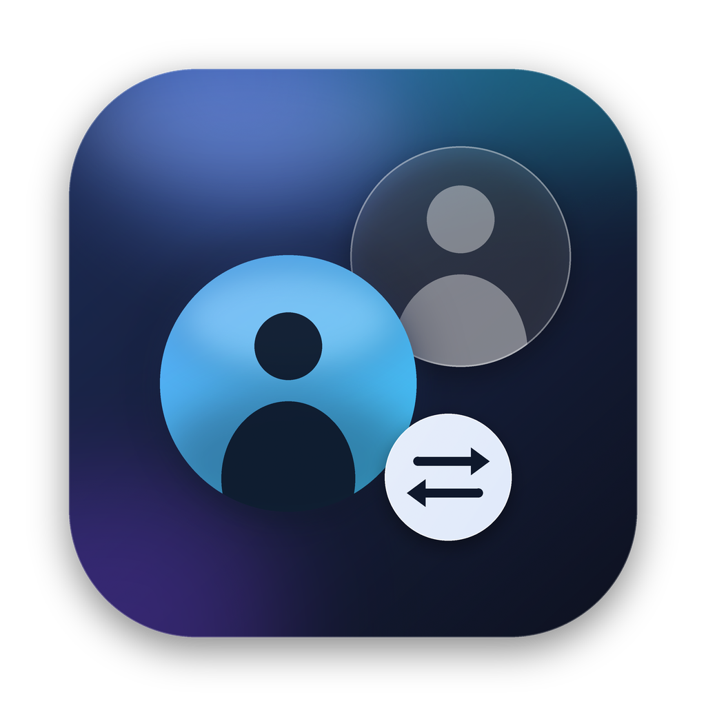

# 实时换脸直播 · Live Face Studio（Deep-Live-Cam 增强版）



在 Mac（Apple Silicon）上运行的**原生桌面 App**：SwiftUI 界面 + AVFoundation 直接采集
摄像头，后台静默调用本地 [Deep-Live-Cam](https://github.com/hacksider/Deep-Live-Cam)
的 buffalo_l 检测与 inswapper_128_fp16 换脸（CoreML/ANE 加速），结果实时显示在 App 内，
并可弹出纯净输出窗口给 OBS。**不需要打开网页。**

## 界面预览

<p align="center"></p>

<p align="center"><sub>主界面 · 空白照片库（截图不含任何人物照片）</sub></p>

<p align="center"></p>

<p align="center"><sub>设置窗口：设备、录制、换头微调、状态与 OBS</sub></p>

顶部提供 **截图 / 录制 / 保存目录**；侧栏「模式」切换换脸/换头；
右上角齿轮（或 `⌘,`）打开**设置**：设备、录制、换头微调、状态与 OBS。

> 截图使用空白照片库与待机画面，不含任何人物照片或个人信息。

## 工作流程

<p align="center"></p>

一帧画面从 AVFoundation 采集，经本地 aiohttp 服务交给 Deep-Live-Cam（CoreML/ANE）
检测与换脸，再回到 App 预览和 OBS 输出窗口；照片与画面都不离开本机。

Python 换脸服务由 App 在后台启动/复用，全程无终端、无浏览器。

> 本仓库是 [hacksider/Deep-Live-Cam](https://github.com/hacksider/Deep-Live-Cam) 的增强 fork：
> 上游检测/换脸源码保留在根目录 `modules/`，本仓库新增原生 macOS App、实时后台、网页调试版与构建脚本。
> 上游原有 GUI 仍可使用：`.venv/bin/python run.py`。

## 快速开始

### 首次安装

```bash
git clone https://github.com/tsingke/Deep-Live-Cam.git
cd Deep-Live-Cam
python3.12 -m venv .venv
.venv/bin/pip install -r requirements.txt -r requirements-web.txt
./make_app.sh --install
```

首次启动会自动下载模型到 `models/` 和 `~/.insightface/models/buffalo_l/`（约 1.1GB），
并使用 CoreML 编译（1–3 分钟）。构建 App 需要 macOS 的 Command Line Tools。

### 使用

双击 **`LiveFace.app`**（项目根目录或 `~/Applications`，Spotlight 搜 **LiveFace**）。

1. 首次启动会请求**摄像头权限**（请允许）。
2. 拖入或点击上传 1–9 张人像照片（自动提取人脸特征）。
3. 点「开始直播」；按 **空格** 也可开始/停止。
4. 点「输出窗口」，把弹出的纯净画面窗口留给 OBS 采集。
5. 顶部可 **截图**（`⌘S`）或 **录制**（`⌘R`）；文件夹按钮选择保存目录。

> 换脸服务只监听 `127.0.0.1`，不会暴露到局域网/公网。App 退出时若服务是它启动的，
> 会一并停止；服务闲置 **2 小时**也会自动退出（下次点开始会自动重启）。

<details>
<summary>网页版（调试用，可选）</summary>

`start.command` 仍保留浏览器控制台，连接同一个后台服务；日常使用不需要它。
</details>

## 使用说明

### 照片库
- 支持一次上传多张；也可以把图片直接**拖进 App 窗口**。
- 点击缩略图或按 **1–9** 实时切换，不断流。
- 每张照片会自动用 buffalo_l 检测最大人脸并提取 512 维特征。
- 照片保存在 `photos/`，索引在 `photos/library.json`，重启 App 后自动恢复。

### 设备选择
- 设置（齿轮 / `⌘,`）→「设备」可选择外接摄像头/麦克风；**停止直播/录制后**切换。
- 未选择时使用系统默认设备；设备变化后可点「刷新」重新枚举。
- 外接设备未显示时，确认已连接并在系统设置中允许 LiveFace 访问摄像头/麦克风。

### 换脸人数与锁定主角

- 侧栏「换脸人数」可选 **1 人（主角）/ 2 人 / 3 人 / 全部**。
- 「1 人（主角）」会锁定画面中最大、最靠中心的那个人：**只换主角，其他人不换**；
  主角离开画面时宁可不换，也不会换到别人身上。
- 直播中直接**点击画面里的人脸**即可锁定/切换主角；点「自动选择」恢复自动锁定。
- 选 2/3/全部时，按人脸从大到小换相应数量；点击某张脸会把它作为第一主角。
- 停止 5 秒以上再开始（或重启 App）会重新自动锁定。
- 多换人、主角身份识别会增加一点耗时；近距离大脸也会让换脸变慢，离镜头稍远更流畅。

### 换脸 / 换头（实验）

侧栏 **模式** 可自由选择：

| 模式 | 说明 |
|---|---|
| **换脸（仅面部）** | 只替换面部，速度最快、最稳定 |
| **换头（实验）** | 在换脸基础上，叠加源照片的**发型、耳朵和头部轮廓**；保留目标表情/口型 |

换头使用 macOS **Vision 人像分割**提取源头部（首次处理源照片后缓存），再按五点关键点对齐融合。
它**不是 3D 生成式整头替换**；拍摄角度、光线、发型差异大时会看到接缝。**正脸、半身照、光源接近** 时效果最好。
第一次切到换头会构建头部遮罩，首帧可能多等约 1 秒；之后每帧大约多 10–20ms。

在 **设置 →「换头」** 可继续微调：**换头强度**（默认 `90%`）、**头部缩放**（默认 `100%`）、
**上下微调**（默认 `0%`）、**左右微调**（默认 `0%`）。强度 `0` 等于仅换脸；缩放/偏移可减少接缝。
「应用预设」可快速切换：自然（70/98/0）、均衡（90/100/0）、明显（100/104/0）。

### 音画同步（可选固定延迟）
App 侧栏的 **固定延迟** 控制每一帧在「拍摄后 N 毫秒」才上屏：

| 固定延迟 | 效果 |
|---|---|
| `0 ms` | 最低延迟（处理完立刻显示），音画可能不同步（视频比声音晚约 40–80ms） |
| `300 ms` | 视频固定晚 300ms，画面不抖；把 OBS 麦克风的「同步偏移」也设为 **300** |

OBS 设置：`麦克风 → 高级音频属性 → 同步偏移 = 与 App 中相同的毫秒数`。

### 截图与录制

- 顶部 **截图** 或 `⌘S`：把当前换脸后的干净画面保存为 PNG。
- 顶部 **录制** 或 `⌘R`：开始/停止 H.264 MP4 录制；录制时显示 REC 计时。
- 录制中可点顶部**暂停/继续**按钮或 `⌘P`：暂停时麦克风停止，继续后写入**同一个文件**，暂停时间不会保留为空白；REC 计时只计算实际录制时长。
- 文件夹按钮 / 菜单「直播 → 选择保存目录…」：选择保存目录；默认 `~/Movies/LiveFace`。
- 录制的是 App 预览里的换脸画面与麦克风，**不含 UI 控件、原始画面 PiP 或输出窗口**。
- 视频默认包含**麦克风音频**；首次录制会请求权限，拒绝则只录画面（可在系统设置重新开启）。
- 停止直播或退出 App 会自动结束录制，并停止麦克风。
- 设置 →「录制」：倒计时可选关闭 / 3 秒 / 5 秒；倒计时中可点「取消」或再次点录制取消。
- 设置 →「录制」：画质可选 4 / 8 / 12 Mbps；麦克风可关闭，录制无音频视频。
- 设置 →「录制」：最长录制可选不限 / 1 / 5 / 10 / 30 分钟，到时自动停止并保存。
- 最近文件删除需确认；删除的只是本 App 生成的 `LiveFace_` 文件。
- 录制时窗口顶部显示**麦克风电平**，绿色/黄色/红色提示输入强弱。
- 设置 →「录制」→「最近文件」会列出最近 5 个 `LiveFace_` 截图/视频，可直接打开、在 Finder 中显示或删除。

### OBS 采集
1. App 点 **输出窗口**，弹出只显示换脸画面的 1280×720 窗口（黑底、无控件、自动等比留边）。
2. OBS 添加 **窗口采集**，选择窗口 `实时换脸输出`。
3. 设置 →「状态与 OBS」可开启**输出窗口置顶**；输出窗口和主窗口的位置/大小会自动记住。
4. 第一次使用需在「系统设置 → 隐私与安全性 → 屏幕录制」中允许 OBS。
5. 输出窗口内按 `F` 或双击全屏，`Esc` 关闭；1.8 秒不动鼠标自动隐藏光标。

### 保持流畅的小贴士
- 直播时关掉 Parallels 虚拟机、长时间视频/音乐等重负载应用，能给 ANE/GPU 让路。
- 换脸耗时随人脸像素面积增长：720p 里约 100px 的脸 ~67ms；占满画面的特写
  约 120ms，帧率会相应下降。离镜头稍远一点会更流畅。
- 摄像头建议 1280×720@30；4K 采集会让 JPEG 编解码成为瓶颈。
- 换头模式每帧会多约 10–20ms；本地录制本身开销很小。
- 首次点开始时若没有画面，检查「系统设置 → 隐私与安全性 → 摄像头」是否允许 LiveFace。

## 原生 App 与图标

- `LiveFace.app`：SwiftUI 原生界面 + AVFoundation 摄像头；后台静默启动/复用
  Python 换脸服务，**不打开浏览器**。主界面包含照片库、换脸/换头模式、延迟/画质、FPS/延迟/丢帧和顶部快捷截图/录制；
  设置窗口集中设备、录制、换头微调、状态与 OBS；另有独立的纯净输出窗口。
- 快捷键：`空格` 开始/停止，`1–9` 切换人物，`⌘⇧O` 打开输出窗口，
  `⌘S` 截图，`⌘R` 开始/停止录制，`⌘P` 暂停/继续录制，`⌘,` 打开设置。
- 退出 App 时，如果后台服务是它启动的，会一并停止；外部已运行的服务不受影响。
- 图标：`assets/AppIcon.png` / `AppIcon.icns`，深色玻璃底 + 双头像 + 双向箭头，
  3× 超采样，16–1024px 全尺寸。
- 构建：
  - `./make_app.sh --install`（推荐）或 `./make_native_app.sh --install`
  - 只需 Command Line Tools（Swift 6.4 / macOS SDK），不需要安装 Xcode。
- App 为本地 ad-hoc 签名；**移动项目目录后**重新执行 `./make_app.sh --install`
  以更新内嵌路径。
- 调试参数（一般用户不用）：`--snapshot /tmp/ui.png` 渲染界面后退出。

## 性能设计

- **最多 2 帧同时处理**：服务端固定 2 个 worker 线程，芯片不空等；JPEG 解码/编码、
  人脸检测、换脸推理都在 worker 内完成。
- **积压丢旧帧**：等待队列只有 1 格，新帧到达时把排队中的旧帧直接作废（HTTP 204），
  App 端 2 个请求在途、忙就跳过这一拍——两处都保证「画面不越拖越晚」。
- **检测降频**：默认每 3 帧检测一次，中间帧复用上一帧的 bbox/kps
  （可在 App 侧栏切换）。
- **CoreML**：inswapper 会话使用 `CoreMLExecutionProvider`（MLProgram / ALL 计算单元），
  检测模型走 CPUAndGPU，两者可以并行占满 ANE 与 GPU。
- **预热**：启动时先跑一次空帧预热检测模型；首次上传照片后用该照片触发一次完整换脸，
  完成 CoreML 首次编译。
- **2 小时闲置退出**：只有帧/上传/切换会刷新活跃时间，App 轮询状态不会阻止退出。

## 实测结果（M3 Pro / 18GB）

测试条件：1280×720 @30fps、JPEG 质量 72，App 同款协议
（8 字节时间戳、最多 2 帧在途、忙则丢拍），固定延迟 300ms。

| 指标 | 结果 |
|---|---|
| 端到端「拍摄 → 服务端返回」 | **p50 76.7 ms / p95 92.4 ms** |
| 服务端单帧总耗时 | p50 75.9 ms（解码 1.3 / 检测 14.4 / 换脸 66.8 / 编码 1.5） |
| 检测复用率 | 66%（每 3 帧检测一次） |
| 实际呈现吞吐 | **21.6 fps**（源 30fps，App 忙丢弃 28%） |
| 固定 300ms 延迟 | 实际 **300.0 ms**，准时率 **100%** |
| 压满吞吐（2 帧始终在途） | 18.6 fps，单帧升到 ~105 ms |
| CoreML vs CPU（单次换脸） | 48 ms vs ~690 ms（约 **14×**） |
| 换头额外开销 | 约 **+10–20 ms/帧**（M3 Pro，960×1137 测试图） |
| 服务启动时间 | 冷启动 41 s；热启动 16 s；检测预热 60–100 ms；换脸预热 0.1–0.9 s |

> 原生 App 实测 **20.5 fps / 80 ms**，输出窗口同步正常。
> 真实摄像头近距离大脸时约 **6–12 fps**；离镜头远一点、关闭 Parallels 等重负载应用可回到 15–20 fps。
> 21fps 已是这块 M3 Pro 上 inswapper 128 的 ANE 上限：单流 48ms，
> 2 帧并发时 ANE 序列化导致单帧 ~66ms。M4/M5 会更快。
> 换脸有效性用 512 维人脸特征验证：换脸后最左脸与源人物余弦相似度
> **0.914**，与原目标脸仅 0.222。


## 文件结构

```
tsingke/Deep-Live-Cam/
├─ LiveFace.app               # 构建产物（不入库；./make_app.sh 生成）
├─ native/                    # SwiftUI 源码
│  ├─ LiveFaceApp.swift       # App 入口、菜单、快照
│  ├─ ContentView.swift       # 原生界面
│  ├─ AppModel.swift          # 状态、统计、快捷键、输出窗口
│  ├─ BackendClient.swift     # 启动/复用 Python 服务、HTTP API
│  ├─ CameraController.swift  # AVFoundation 采集 → JPEG → 换脸 → 延迟上屏
│  ├─ OutputWindow.swift      # OBS 纯净输出窗口
│  ├─ MediaCapture.swift      # PNG 截图 / H.264 录制
│  ├─ AudioCapture.swift      # 录制期间的麦克风采集与电平
│  ├─ SettingsView.swift      # 设置窗口（设备/录制/换头/状态）
│  ├─ Models.swift            # 服务端数据模型
│  └─ main.swift              # AppKit 入口
├─ make_app.sh                # 构建原生 App（--install 安装到 ~/Applications）
├─ make_native_app.sh         # 原生构建细节
├─ assets/                    # AppIcon.png/.icns + make_icon.py
├─ docs/                      # README 截图与工作流程图
├─ web_server.py              # aiohttp 后台服务（2 处理槽、检测缓存、照片库、闲置退出）
├─ head_swap.py               # 换头：源头部遮罩 + 五点对齐融合
├─ web/                       # 网页版控制台（调试用，可选）
├─ start.command              # 浏览器调试入口
├─ modules/                   # 上游 Deep-Live-Cam 源码（检测/换脸）
├─ models/                    # 模型缓存（自动下载，不入库）
├─ requirements.txt           # 上游 Python 依赖
├─ photos/                    # 上传的照片 + library.json
└─ logs/                      # server.log / native-app.log
```

## 重新构建 App

```bash
./make_app.sh --install
```

移动项目目录后需要重新执行，以更新 App 内嵌路径。
模型合计约 1.1GB（inswapper 2×265MB + buffalo_l 383MB），另需 1–2GB
临时空间供 CoreML 首次编译。

## 故障排查

| 现象 | 处理 |
|---|---|
| App 显示「服务启动失败」 | 看 `logs/native-app.log` / `logs/server.log`；多为模型缺失或网络问题 |
| App 没有摄像头画面 | 系统设置 → 隐私与安全性 → 摄像头 → 允许 LiveFace；确认摄像头未被其他应用占用 |
| 提示「换脸模型正在首次预热」 | 等 1–3 分钟；期间不要重复上传 |
| 点开始直播后 App 退出 | App 会把异常原因写入 `logs/native-crash.log`，请查看该文件 |
| 点击人脸没有锁定 | 需在直播中点击；脸太小/被遮挡时可能无法锁定。点「自动选择」恢复 |
| 截图/录制没有反应 | 先开始直播；截图和录制都需要已显示的换脸画面 |
| 外接摄像头/麦克风看不到 | 停止直播/录制后点「设备 → 刷新」；确认设备已连接并授权 |
| 录制的视频没有声音 | 系统设置 → 隐私与安全性 → 麦克风 → 允许 LiveFace；首次拒绝后重新开始录制 |
| 换头没有变化/接缝明显 | 使用正脸、半身照、接近光源；换头是实验性 2D 融合 |
| `onnxruntime 没有 CoreMLExecutionProvider` | 确认装的是 `onnxruntime==1.28.0`（darwin arm64 wheel），`python -c "import onnxruntime; print(onnxruntime.get_available_providers())"` |
| OBS 窗口采集黑屏 | 给 OBS 屏幕录制权限；输出窗口必须保持可见（不能被完全遮挡/最小化） |
| 端口被占用 | 已有服务在运行；退出旧实例或 `pkill -f web_server.py` 后重启 App |
| 想手动启动 | `.venv/bin/python web_server.py --port 8787` |

## 开发与交接

架构、接口、构建/截图流程、当前状态、已知限制与下一步见 [`docs/HANDOFF.md`](docs/HANDOFF.md)。

测试：

```bash
.venv/bin/python -m unittest discover -s tests -p 'test_*.py' -v
./tests/run_recording_smoke.sh
```

## 合规提醒

实时换脸属于双重用途技术。请仅用于**本人形象、已获授权的人物**或明确标注的娱乐内容；
不要用于冒充他人、诈骗、伪造证据或任何可能误导他人的场景。发布换脸内容时请遵守
当地法律与平台规则。

## 上游与许可

本仓库基于 [hacksider/Deep-Live-Cam](https://github.com/hacksider/Deep-Live-Cam)。
上游代码、模型与许可证见根目录 `LICENSE`。新增的原生 App、实时后台与网页调试界面
为本仓库的增强部分。

## 技术栈

- Python 3.12 / aiohttp / OpenCV / onnxruntime 1.28 (CoreML EP)
- 上游模型：buffalo_l（检测/识别/ landmarks）、inswapper_128_fp16（换脸）
- 原生 App：SwiftUI + AVFoundation + ImageIO，Swift 6.4 / macOS SDK，命令行构建
- 网页调试版：原生 JS + OffscreenCanvas + getUserMedia + BroadcastChannel
